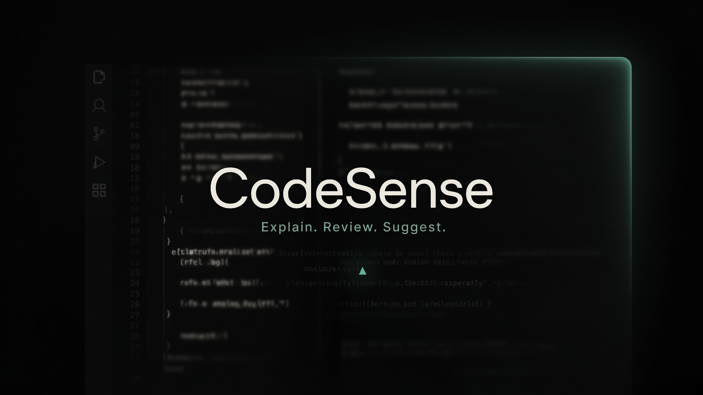

<p align="center">
  
</p>

# CodeSense

**Real-time code explanation, review, and completion — inside your editor.**

CodeSense is a live GenAI code editor that streams fast, focused LLM responses as you select, save, or pause. Three modes — **Explain**, **Review**, and **Suggest** — share a unified SSE gateway. No multi-step agents, no RAG: just open the app and start coding.

<p align="center">
  <a></a>
  <a></a>
  <a></a>
  <a></a>
  <a></a>
</p>

---

## ✨ What it does

| Mode | Trigger | Output |
|------|---------|--------|
| **Explain** | Select code, or press **Ctrl/Cmd+E** | Streaming natural-language explanation (2–4 sentences) |
| **Review** | Press **Ctrl/Cmd+S**, or click **Review** | Structured JSON review: summary, walkthrough, risks, refactor |
| **Suggest** | Pause while typing (debounced) | Inline ghost-text completion — accept with **Tab** |

Additional capabilities:
- **Multi-language support**: TypeScript, JavaScript, Python, Go, Rust, Java, JSON, HTML, CSS, SQL, Markdown
- **Bring Your Own Key (BYOK)**: Paste any provider key in Settings; it stays in your browser's `localStorage`
- **Demo mode**: Fully usable offline with synthetic responses — no API key required
- **Resizable split editor** with an insight panel; mobile-ready bottom sheet
- **Sample files** pre-loaded for every supported language
- **Health endpoint**: `GET /api/codesense`

---

## 🚀 Quick Start

```bash
# 1. Install dependencies
npm install

# 2. Start the dev server (0.0.0.0:8080)
npm run dev

# 3. Open the app
# http://localhost:8080
```

The app is a single-page TanStack Start application. The dev server binds to `0.0.0.0:8080` — the live-preview contract.

### Available scripts

| Script | Purpose |
|--------|---------|
| `npm run dev` | Start dev server on `0.0.0.0:8080` |
| `npm run build` | Production build (Vite + DB migrations) |
| `npm run preview` | Serve the production build locally |
| `npm run typecheck` | TypeScript type checking |
| `npm run lint` | ESLint |
| `npm run format` | Prettier |
| `npm run test` | Unit tests |
| `npm run db:migrate` | Apply PGLite migrations |

---

## 🔑 API Keys & Providers

By default CodeSense runs in **demo mode**, streaming offline synthetic responses so the UI is fully usable without any credentials.

To use real providers, open **Settings** and paste your API key:

| Key prefix | Provider | Default model |
|------------|----------|---------------|
| `sk-ant-…` | Anthropic Claude | claude-3-5-haiku |
| `xai-…` | xAI Grok | grok-4.5 |
| `AIza…` / `AQ…` | Google Gemini | gemini-1.5-flash |
| `sk-…` or other | OpenAI / OpenAI-compatible | gpt-4o-mini |

- The key is stored in `localStorage` and sent per request as `X-Codesense-Key`.
- Provider is auto-detected from the key prefix, or can be overridden via `X-Codesense-Provider`.
- In-app key overrides any server-side env variable.
- Clear the key and save to return to demo mode.

Provider can also be set server-side via environment variables (`ANTHROPIC_API_KEY`, `XAI_API_KEY`, `OPENAI_API_KEY`, `GEMINI_API_KEY`) with model overrides (`ANTHROPIC_MODEL`, `XAI_MODEL`, `OPENAI_MODEL`, `GEMINI_MODEL`).

---

## ⚙️ Settings

Open the Settings sheet from the toolbar to adjust:

| Setting | Range | Default |
|---------|-------|---------|
| Explain on select | toggle | on |
| Review on save | toggle | on |
| Ghost completions (suggest) | toggle | on |
| Debounce delay | 300–1200 ms | 600 ms |
| Theme | dark / light | dark |
| API key | text | (demo mode) |

Changes persist to `localStorage` across sessions.

---

## 🏗️ Architecture

```
┌─────────────────────────┐      ┌──────────────────────────┐
│  Browser (React 19)     │      │  TanStack Start Server   │
│  Monaco Editor + Zustand│      │  SSE gateway (Nitro)     │
└───────────┬─────────────┘      └─────────────┬────────────┘
            │  CodesenseRequest (JSON)         │
            │  mode, language, snippet, cursor │
            └─────────────┬────────────────────┘
                          │ POST /api/codesense
                          ▼
                  ┌───────────────┐
                  │  Rate limiter │ 12 req / 60s per client
                  └───────┬───────┘
                          ▼
                  ┌───────────────┐
                  │  LLM Provider │ Anthropic • xAI • OpenAI • Gemini
                  └───────────────┘
                          │ SSE stream (text/event-stream)
                          ▼
                  Streaming delta → Editor panel
```

### Key design decisions

| Concern | Choice | Reason |
|---------|--------|--------|
| Streaming | SSE over `fetch` | Simple, real-time LLM streaming |
| API keys | Client-side `localStorage` | BYOK; never logged or written to disk by the gateway |
| Rate limit | 12 req / 60s per client IP | Token-bucket in-memory |
| Context window | ±30 / +10 lines around cursor | Keeps input under ~800 tokens |
| Default model | Fast/cheap (Haiku-class) | Prioritizes latency for keystroke UX |
| Ghost text | Monaco native APIs | No DOM hacks; proper editor UX |
| Framework | React 19 + TanStack Start + Vite | Modern full-stack React framework |
| Deploy target | Vercel (Nitro preset) | Zero-config serverless deployment |

### Out of scope (v1)

- Multi-step agent loops / tool execution
- Persistent conversation memory
- RAG / codebase indexing
- Authentication / user accounts (Better Auth is wired but opt-in)
- Jupyter / notebook support

---

## 📁 Project Structure

```
codesense/
├── src/
│   ├── router.tsx              # TanStack router entry (getRouter)
│   ├── styles.css              # Tailwind v4 + base styles
│   ├── routes/
│   │   ├── __root.tsx          # Document shell (AuthProvider, PreviewHostBridge)
│   │   ├── index.tsx           # Home → AppShell
│   │   └── api/
│   │       ├── codesense.ts    # POST /api/codesense (SSE gateway + health)
│   │       ├── review.ts       # POST /api/review (structured review)
│   │       └── detect.ts       # POST /api/detect (provider detection)
│   ├── components/
│   │   ├── editor/             # AppShell, EditorCanvas, Monaco pane, InsightPanel,
│   │   │                         FileTabs, Toolbar, SettingsSheet, StatusBar, …
│   │   └── ui/                 # Radix-based primitives (Button, Sheet, Switch, …)
│   ├── hooks/                  # use-media-query
│   └── lib/
│       ├── codesense/          # Core: provider, prompts, store, stream, rate-limit,
│   │                         snippet, types, parse-review, samples, apiKeyMiddleware
│       ├── auth/               # Better Auth (gates, middleware, providers, session)
│       ├── db.ts               # PGLite database + migrations
│       └── utils.ts
├── public/
│   ├── head-image.jpg          # README banner
│   ├── favicon.svg
│   ├── og.jpg                  # Open Graph image
│   └── __grok/                 # PWA install assets (platform chrome)
├── migrations/                 # PGLite SQL migrations
├── scripts/                    # Vite env, PWA plugin, migrate, preview
├── vite.config.ts              # Vite + TanStack Start + Nitro
├── tsconfig.json
├── package.json
└── startup.sh                  # Dev server restart contract
```

---

## 🔌 API Reference

### POST /api/codesense
Streaming endpoint for all three modes. Body: `{ mode, language, snippet, cursorLine, cursorCol }`. Returns `text/event-stream`.

### POST /api/review
Structured review endpoint. Accepts optional `X-Codesense-Key` / `X-Codesense-Provider` headers. Returns `SSE stream of JSON review`.

### POST /api/detect
Provider detection endpoint.

### GET /api/codesense
Health check. Returns `{ available, model }`.

### Rate limiting
- **12 requests per 60-second window** per client IP (X-Forwarded-For / X-Real-IP).
- 429 Too Many Requests with Retry-After header when exhausted.


## 🤝 Contributing

Contributions are welcome! Please fork the repo and submit a pull request.

---

## 📄 License

MIT — use it, fork it, ship it.


